<div align="center">


# MTGA Companion

**Deck tracker y historial de partidas para Magic: The Gathering Arena en Linux.**  
*A native deck tracker and match history for Magic: The Gathering Arena on Linux.*

[](https://github.com/rouxed/mtga-companion/releases)
[](https://www.python.org/)
[](https://www.riverbankcomputing.com/software/pyqt/)
[](https://www.kernel.org/)
[](https://appimage.org/)
[](#idioma)

[Español](#español) · [English](#english)

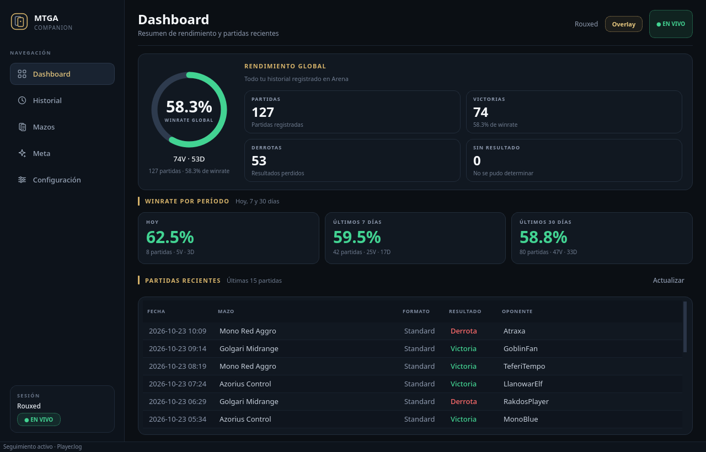

</div>

---

## Español

**MTGA Companion** es una aplicación de escritorio nativa para Linux que lee el `Player.log` de **MTG Arena** en tiempo real y te muestra estadísticas, historial, mazos, meta decks y un overlay opcional durante la partida.

Está pensada para jugar en **Wayland** sin sacrificar el overlay: la ventana principal corre de forma nativa y el overlay se ejecuta en un proceso XCB/XWayland separado, siempre encima del juego.

> **Datos de demostración:** las capturas usan un historial y mazos de ejemplo, no datos reales de ninguna cuenta.

### Capturas

| Dashboard | Historial |
|:---:|:---:|
|  | 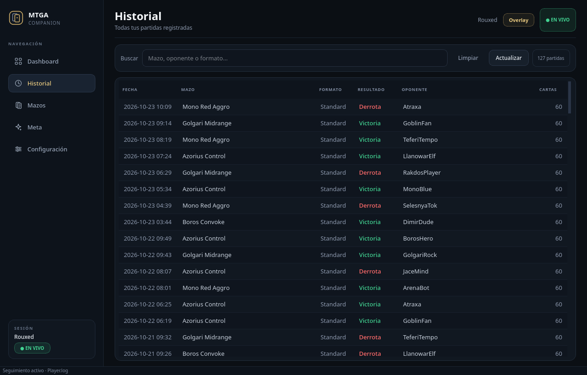 |
| **Mazos** | **Meta** |
|  | 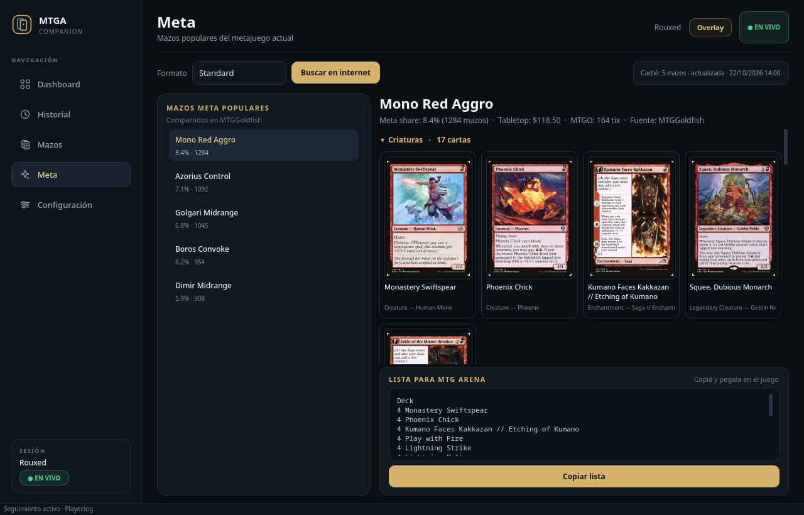 |
| **Overlay en partida** | **Configuración** |
| 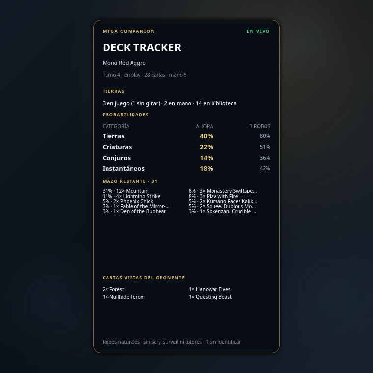 | 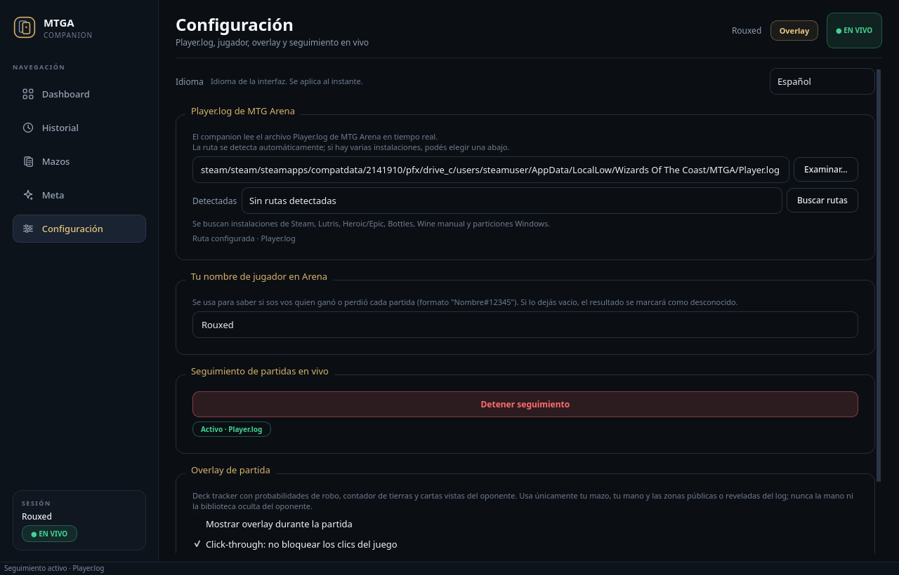 |

### Funciones

- **Dashboard**: winrate global, victorias, derrotas, partidas sin resultado y winrate de hoy, últimos 7 días y últimos 30 días.
- **Historial**: todas las partidas registradas con fecha, mazo, formato, resultado, oponente y cantidad de cartas. Incluye búsqueda por mazo, oponente o formato.
- **Mazos**: tus mazos agrupados por tipo de carta, con imágenes reales de Scryfall y estadísticas por mazo.
- **Meta**: mazos populares de MTGGoldfish para Standard, Historic, Explorer y Alchemy, con meta share, precios, decklist, banquillo y exportación lista para importar en Arena.
- **Overlay opcional**: probabilidades de robo, contador de tierras, cartas restantes y cartas del oponente vistas en zonas públicas o reveladas.
- **Privacidad primero**: solo lee el `Player.log`. No lee memoria del juego, no accede a la biblioteca oculta ni a la mano oculta del oponente.
- **Español e inglés**: la interfaz completa se puede cambiar en caliente desde Configuración, sin reiniciar la aplicación.
- **Tema oscuro**: interfaz nativa con estilo Arena, pensada para acompañar la partida.

### Privacidad

El companion **no** usa memoria del juego, **no** lee la mano oculta del oponente y **no** intenta obtener la carta superior de la biblioteca. Toda la información del oponente sale de zonas públicas o reveladas del `Player.log`; las probabilidades se calculan solo con tu mazo y tu mano.

La base de datos, la caché de cartas y los ajustes se guardan localmente en tus directorios XDG:

```text
~/.local/share/mtga-companion/
~/.config/mtga-companion/
```

### Instalación

#### AppImage (recomendado)

Descargá el AppImage desde [Releases](https://github.com/rouxed/mtga-companion/releases/latest):

```bash
chmod +x MTGA-Companion-0.1.0-x86_64.AppImage
./MTGA-Companion-0.1.0-x86_64.AppImage
```

En Arch Linux, el AppImage necesita FUSE 2:

```bash
sudo pacman -S --needed fuse2
```

Si tu sistema no permite montar AppImages, usá el modo de extracción:

```bash
APPIMAGE_EXTRACT_AND_RUN=1 ./MTGA-Companion-0.1.0-x86_64.AppImage
```

#### Desde el código fuente

Requisitos: Linux, Python 3.11+ y las dependencias de `mtga_companion/requirements.txt`.

```bash
git clone https://github.com/rouxed/mtga-companion.git
cd mtga-companion
python -m venv .venv
source .venv/bin/activate
pip install -r mtga_companion/requirements.txt
python -m mtga_companion
```

También podés usar el lanzador incluido:

```bash
./run.sh
```

#### Arch Linux / AUR

El `PKGBUILD` de `mtga-companion-bin` está incluido en:

```text
packaging/aur/mtga-companion-bin/
```

Para probarlo localmente:

```bash
cd packaging/aur/mtga-companion-bin
makepkg -si
```

El paquete instala el AppImage del release, el lanzador `mtga-companion`, el icono y el archivo `.desktop`. Las instrucciones de publicación están en [`packaging/aur/README.md`](packaging/aur/README.md).

### Uso

1. Abrí **MTG Arena**.
2. Iniciá **MTGA Companion**.
3. La aplicación detecta automáticamente el `Player.log` de Steam/Proton, Lutris, Heroic/Epic, Bottles, Wine manual o una partición Windows.
4. Si hay varias instalaciones, elegí la ruta correcta en **Configuración → Player.log de MTG Arena**.
5. El historial y las estadísticas se actualizan al terminar cada partida.

El overlay está desactivado por defecto. Se activa desde **Configuración → Overlay de partida**, donde también podés elegir posición, opacidad y click-through.

### Idioma

La aplicación arranca en **español** por defecto. El idioma se cambia manualmente en **Configuración → Idioma** y se guarda en `settings.json`:

```json
{
  "language": "en"
}
```

No se detecta automáticamente desde el locale del sistema. El overlay recibe el idioma mediante `MTGA_COMPANION_LANG` y se reinicia con la traducción elegida.

### Overlay y Wayland

- La ventana principal puede ejecutarse de forma nativa en Wayland.
- El overlay se lanza como un proceso hijo con backend XCB/XWayland para poder usar una ventana transparente, click-through y siempre encima de Arena.
- El estado del overlay, la posición, la opacidad y el click-through se conservan entre sesiones.
- El overlay es opcional y no bloquea los clics del juego cuando `click-through` está activo.

### Desarrollo

```bash
python -m venv .venv
source .venv/bin/activate
pip install -r requirements-dev.txt
pytest -q
ruff check --select F,E9 mtga_companion tests
```

Para generar el AppImage:

```bash
./packaging/build_appimage.sh
```

El resultado queda en `dist/MTGA-Companion-0.1.0-x86_64.AppImage`.

### Estructura

```text
mtga_companion/
  main.py           # Entrada de la aplicación
  i18n.py           # Traducciones español/inglés
  config.py         # Rutas XDG, migración y detección de Player.log
  database.py       # SQLite: partidas, mazos y estadísticas
  log_watcher.py    # Seguimiento del Player.log
  parser.py         # Parseo de eventos de MTG Arena
  game_state.py     # Estado de la partida y cartas reveladas
  draw_odds.py      # Probabilidades hipergeométricas
  scryfall.py       # Imágenes y metadatos de cartas
  meta_fetcher.py   # MTGGoldfish, caché y fallback
  overlay_window.py # UI del overlay
  overlay_process.py # Proceso XCB del overlay
  gui/              # Ventana principal y pestañas
tests/              # Suite de pruebas
packaging/          # PyInstaller, AppImage, .desktop, AUR
docs/screenshots/   # Capturas para este README
```

### Estado

Versión **0.1.0**. Suite de pruebas: **140 tests**.

### Aviso legal

Proyecto personal, no afiliado a Wizards of the Coast, Hasbro ni Untapped.gg. *Magic: The Gathering Arena* y sus marcas pertenecen a Wizards of the Coast. Las imágenes de cartas se obtienen de Scryfall; los datos de meta, de MTGGoldfish.

---

## English

**MTGA Companion** is a native Linux desktop app that tails the **MTG Arena** `Player.log` in real time and gives you match history, deck stats, meta decks, and an optional in-game overlay.

It is designed for **Wayland** without giving up the overlay: the main window runs natively, while the overlay runs in a separate XCB/XWayland process and stays above the game.

> **Demo data:** the screenshots use a sample history and sample decks, not real account data.

### Screenshots

| Dashboard | History |
|:---:|:---:|
| 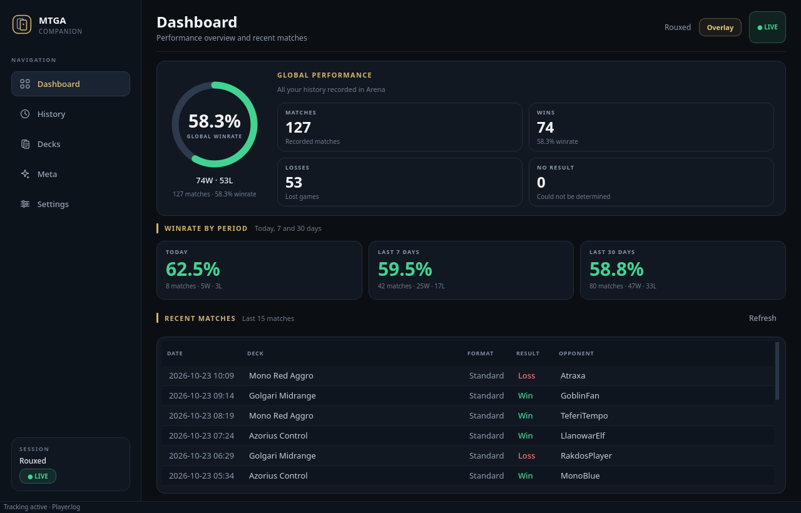 | 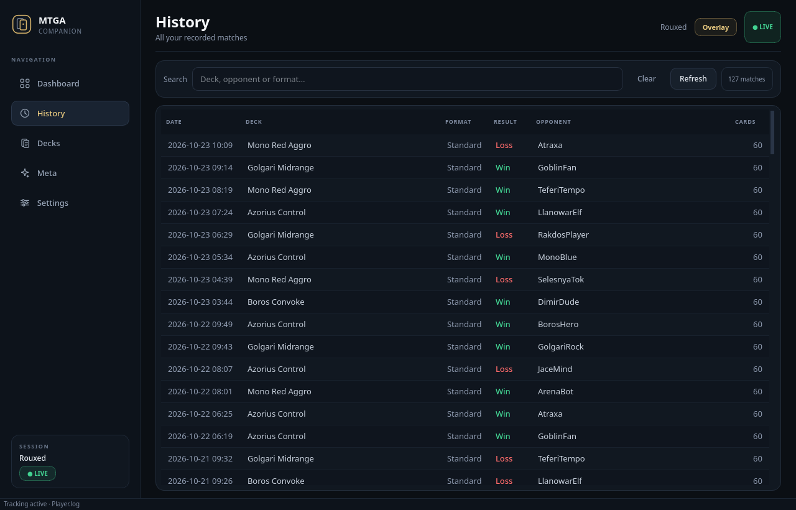 |
| **Decks** | **Meta** |
| 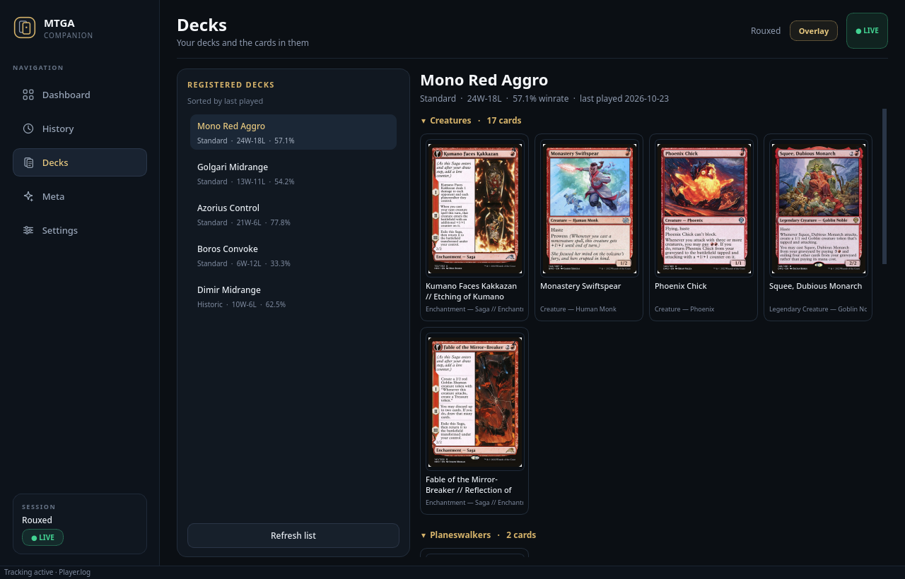 | 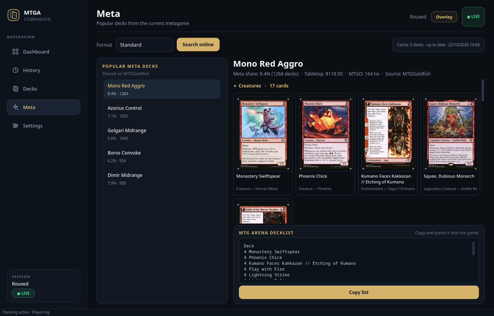 |
| **In-game overlay** | **Settings** |
| 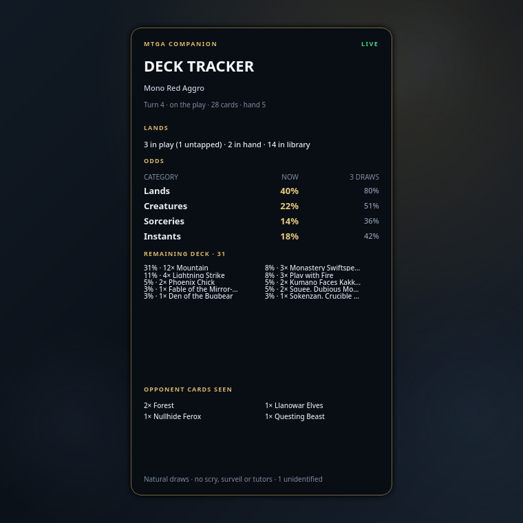 | 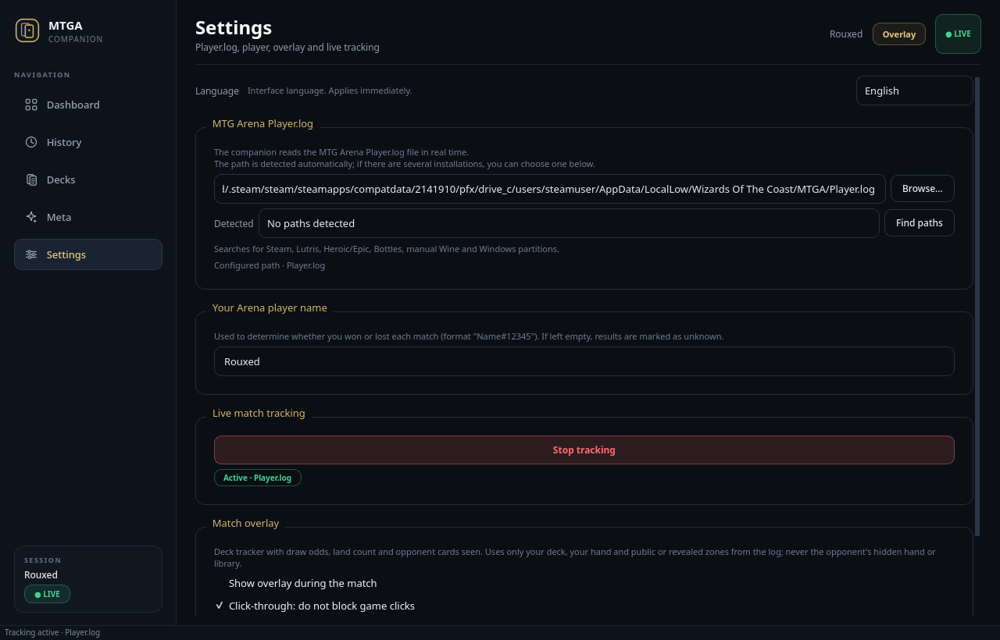 |

### Features

- **Dashboard**: overall winrate, wins, losses, unknown results, and winrate for today, the last 7 days, and the last 30 days.
- **History**: every recorded match with date, deck, format, result, opponent, and card count. Search by deck, opponent, or format.
- **Decks**: your decks grouped by card type, with real Scryfall card art and per-deck stats.
- **Meta**: popular MTGGoldfish decks for Standard, Historic, Explorer, and Alchemy, with meta share, prices, decklist, sideboard, and a ready-to-paste Arena export.
- **Optional overlay**: draw odds, land count, remaining deck, and opponent cards seen in public or revealed zones.
- **Privacy first**: reads only `Player.log`. It does not read game memory, the hidden library, or the opponent's hidden hand.
- **Spanish and English**: switch the entire UI live from Settings, without restarting the app.
- **Dark theme**: a native Arena-inspired interface built for side-by-side play.

### Privacy

The companion **does not** read game memory, the opponent's hidden hand, or the top card of the library. All opponent information comes from public or revealed zones in `Player.log`; draw odds are calculated only from your deck and hand.

The database, card cache, and settings stay local in your XDG directories:

```text
~/.local/share/mtga-companion/
~/.config/mtga-companion/
```

### Installation

#### AppImage (recommended)

Download the AppImage from [Releases](https://github.com/rouxed/mtga-companion/releases/latest):

```bash
chmod +x MTGA-Companion-0.1.0-x86_64.AppImage
./MTGA-Companion-0.1.0-x86_64.AppImage
```

On Arch Linux, the AppImage needs FUSE 2:

```bash
sudo pacman -S --needed fuse2
```

If your system cannot mount AppImages, use extract-and-run mode:

```bash
APPIMAGE_EXTRACT_AND_RUN=1 ./MTGA-Companion-0.1.0-x86_64.AppImage
```

#### From source

Requirements: Linux, Python 3.11+, and the packages in `mtga_companion/requirements.txt`.

```bash
git clone https://github.com/rouxed/mtga-companion.git
cd mtga-companion
python -m venv .venv
source .venv/bin/activate
pip install -r mtga_companion/requirements.txt
python -m mtga_companion
```

Or use the included launcher:

```bash
./run.sh
```

#### Arch Linux / AUR

The `mtga-companion-bin` `PKGBUILD` lives in:

```text
packaging/aur/mtga-companion-bin/
```

To test it locally:

```bash
cd packaging/aur/mtga-companion-bin
makepkg -si
```

The package installs the release AppImage, the `mtga-companion` launcher, the icon, and the `.desktop` file. Publishing notes are in [`packaging/aur/README.md`](packaging/aur/README.md).

### Usage

1. Open **MTG Arena**.
2. Start **MTGA Companion**.
3. The app automatically detects the `Player.log` from Steam/Proton, Lutris, Heroic/Epic, Bottles, manual Wine, or a Windows partition.
4. If you have multiple installations, pick the right path in **Settings → MTG Arena Player.log**.
5. History and stats update when each match ends.

The overlay is disabled by default. Enable it in **Settings → Match overlay**, where you can also choose position, opacity, and click-through.

### Language

The app starts in **Spanish** by default. Change it manually in **Settings → Language**; the choice is stored in `settings.json`:

```json
{
  "language": "en"
}
```

It is not auto-detected from the system locale. The overlay receives the language through `MTGA_COMPANION_LANG` and restarts with the selected translation.

### Overlay and Wayland

- The main window can run natively on Wayland.
- The overlay is launched as a child process with the XCB/XWayland backend so it can be transparent, click-through, and always on top of Arena.
- Overlay state, position, opacity, and click-through are preserved between sessions.
- The overlay is optional and does not block game clicks when `click-through` is enabled.

### Development

```bash
python -m venv .venv
source .venv/bin/activate
pip install -r requirements-dev.txt
pytest -q
ruff check --select F,E9 mtga_companion tests
```

Build the AppImage:

```bash
./packaging/build_appimage.sh
```

The result is written to `dist/MTGA-Companion-0.1.0-x86_64.AppImage`.

### Project layout

```text
mtga_companion/
  main.py           # Application entry point
  i18n.py           # Spanish/English translations
  config.py         # XDG paths, migration, Player.log discovery
  database.py       # SQLite: matches, decks, stats
  log_watcher.py    # Player.log tailer
  parser.py         # MTG Arena event parser
  game_state.py     # Match state and revealed cards
  draw_odds.py      # Hypergeometric draw odds
  scryfall.py       # Card art and metadata
  meta_fetcher.py   # MTGGoldfish, cache, and fallback
  overlay_window.py # Overlay UI
  overlay_process.py # XCB overlay process
  gui/              # Main window and tabs
tests/              # Test suite
packaging/          # PyInstaller, AppImage, .desktop, AUR
docs/screenshots/   # README screenshots
```

### Status

Version **0.1.0**. Test suite: **140 tests**.

### Legal

Personal project, not affiliated with Wizards of the Coast, Hasbro, or Untapped.gg. *Magic: The Gathering Arena* and its marks belong to Wizards of the Coast. Card images are provided by Scryfall; meta data by MTGGoldfish.
